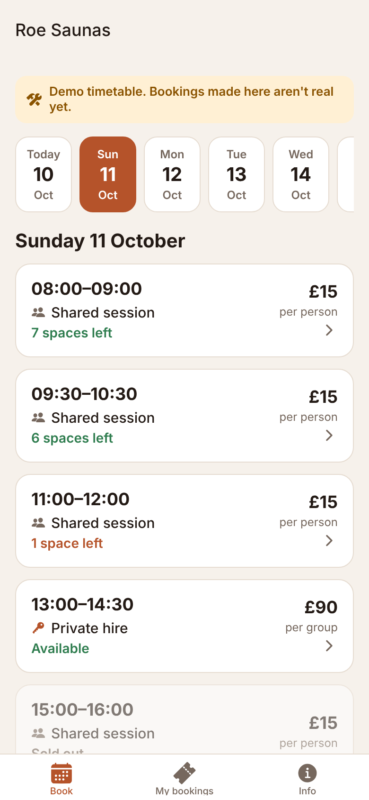
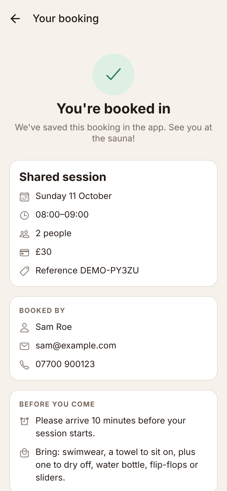
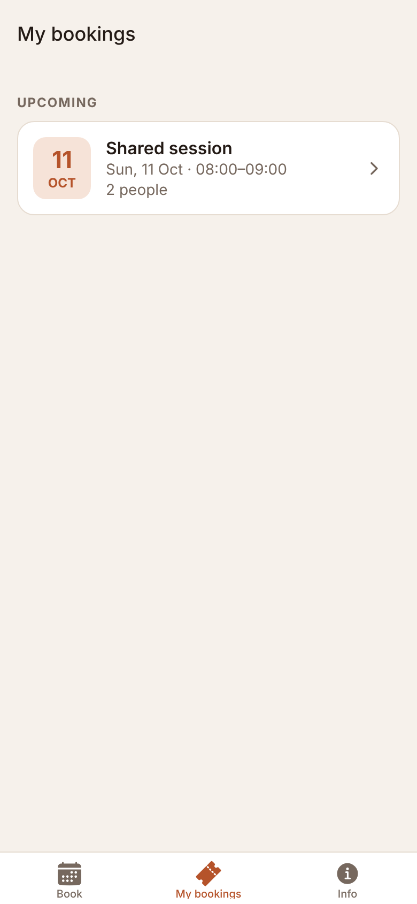

# Roe Saunas app

The booking app for [Roe Saunas](https://roe-saunas.co.uk), for iPhone and Android.

<p>
  
  
  
</p>

## What it does

- **Book**: pick a day (two weeks ahead) and see the sessions, prices and spaces left.
  - **Shared sessions**: book one or more spaces at a per-person price.
  - **Private hire**: book the whole sauna for a group at one price.
- **Booking**: enter your name, email and mobile number (remembered for next time), see the total, and confirm.
- **My bookings**: upcoming and past bookings, with booking details and cancellation.
- **Info**: what to bring, house rules, cancellation policy, and links to the website and contact details.

> **The app is currently running on a demo timetable.** Sessions, prices and spaces are made up, and bookings only exist on the phone they were made on. A banner says so in the app. Connect a real booking system before publishing (see below).

## Things to change before publishing

1. **Business details**: `src/config.ts` holds the contact details, address, what to bring, house rules and cancellation policy. All of it is placeholder text.
2. **Connect your booking system** (below).
3. **App icon and splash screen**: replace the Expo placeholders in `assets/` with your logo.
4. **App identifiers**: `app.json` uses `uk.co.roesaunas.app` for both stores. You can't change it once the app is published, so change it now if you want something else.

## Connecting your website's booking system

The app and the website should share **one** booking system. Then a space booked in the app disappears from the website straight away, and the reverse.

The app talks to bookings through one small interface, `BookingService` in `src/booking/types.ts`:

| Method | What it does |
| --- | --- |
| `listSessions(date)` | Sessions on a day, with price and spaces left |
| `getSession(id)` | One session |
| `createBooking(request)` | Books spaces for a customer |
| `cancelBooking(booking)` | Cancels a booking |

Right now `src/booking/index.ts` uses `DemoBookingService`. To go live:

1. **Choose a booking system with an API** that supports group capacity (several people in one timed session), if you haven't already. Check it lets other software list availability **and create bookings**; some booking APIs can only read.
2. **Use a small server between the app and the booking system.** Anything shipped inside an app can be extracted, so the booking system's secret API key mustn't go in the app. A small serverless function (for example on Cloudflare Workers, Vercel or Netlify) holds the key and passes requests through.
3. **Write a `BookingService` that calls that server**, and switch `src/booking/index.ts` to it. The demo banner disappears automatically once `isDemo` is `false`.
4. **Payments**: let the booking system take card payment (most connect to Stripe or Square). Sauna sessions are a real-world service, so Apple and Google don't require in-app purchase or take a cut.

If your booking system has no usable API, the fallback is to open its booking page in the app. That works, but Apple sometimes rejects apps that are mainly a website, so keep the app's own screens (timetable, My bookings, Info).

## Running it

You need [Node.js](https://nodejs.org) 20 or newer on your computer.

```bash
npm install
npm start
```

Install **Expo Go** on your phone ([iPhone](https://apps.apple.com/app/expo-go/id982107779), [Android](https://play.google.com/store/apps/details?id=host.exp.exponent)) and scan the QR code that appears. Press `w` to open it in a web browser instead.

## Publishing to the App Store and Google Play

The app is built with [Expo](https://expo.dev), which builds both store versions in the cloud. You don't need a Mac.

1. Sign up for an [Apple Developer account](https://developer.apple.com/programs/) (yearly fee) and a [Google Play developer account](https://play.google.com/console/signup) (one-off fee). You can register as a business. A personal Google Play account needs a closed test with real testers before it can publish; a business account doesn't.
2. Create a free [Expo account](https://expo.dev/signup).
3. Build and submit:
   ```bash
   npx eas-cli@latest build --platform all --profile production
   npx eas-cli@latest submit --platform ios
   npx eas-cli@latest submit --platform android
   ```
4. Fill in the store listings: screenshots, description, a privacy policy URL (the app collects name, email and phone number), and a support URL. A page on roe-saunas.co.uk works for both.

## For developers

Expo SDK 57, React Native, TypeScript, Expo Router.

```
src/
  app/                 screens (file-based routes)
    (tabs)/            Book, My bookings, Info
    book/[id].tsx      booking form for a session
    booking/[id].tsx   booking confirmation and details
  booking/             BookingService interface + demo implementation
  store/               saved bookings and customer details (AsyncStorage)
  components/ui.tsx    shared UI
  config.ts            business details
  format.ts            prices, dates and times (en-GB, GBP)
  theme.ts             light and dark colours
```

```bash
npm run typecheck
npm run lint
```
