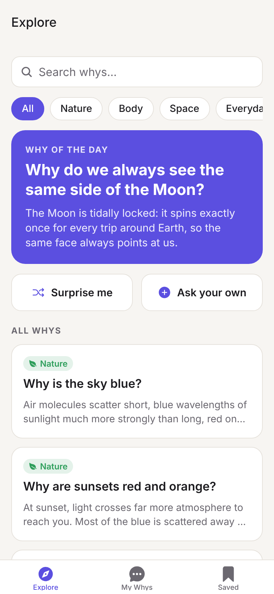
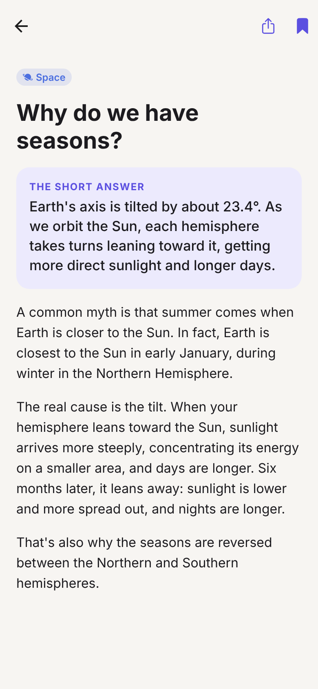
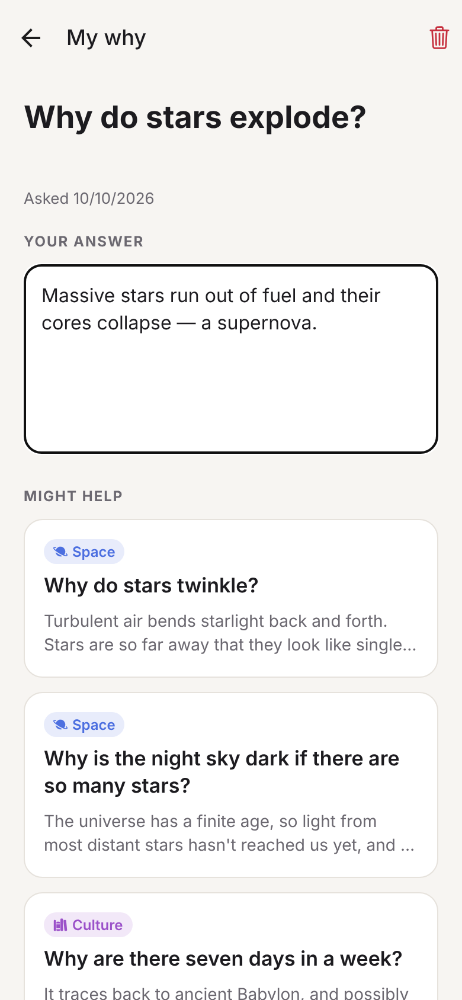

# Why?

A mobile app for curious people. Browse clear explanations of everyday "why" questions, and keep track of your own.

<p>
  
  
  
</p>

## Features

- **Explore**: a "why of the day", 25 hand-written explanations across Nature, Body, Space, Everyday and Culture, search, category filters, and a *Surprise me* button. Each explanation has a short answer, a longer explanation, and related whys to keep digging. Questions science hasn't settled are tagged *Still a mystery*.
- **My Whys**: write down questions as they occur to you, then add your own answers or notes as you learn. Filter by open or answered. While you type, the app suggests library entries that might already answer it.
- **Saved**: bookmark explanations you want to come back to, or share them.
- Works offline. Everything is stored on the device. Light and dark mode.

## Run it

You need Node.js 20 or newer.

```bash
npm install
npm start
```

Then scan the QR code with the [Expo Go](https://expo.dev/go) app on your phone (iOS or Android), or press `w` to open it in a browser.

## Develop

Built with [Expo](https://expo.dev) (SDK 57), React Native, TypeScript and Expo Router.

```
src/
  app/              screens (file-based routes)
    (tabs)/         Explore, My Whys, Saved
    why/[id].tsx    library explanation
    mine/[id].tsx   your question + answer
    ask.tsx         "Ask a why" modal
  components/ui.tsx shared UI pieces
  data/whys.ts      the library of explanations + search
  store/WhyStore.tsx saved items and your questions (AsyncStorage)
  theme.ts          colours for light/dark mode
```

To add a new explanation, append an entry to `WHYS` in `src/data/whys.ts`.

```bash
npm run typecheck
npm run lint
```

To build installable apps for the App Store and Google Play, use [EAS Build](https://docs.expo.dev/build/introduction/): `npx eas-cli@latest build`.
